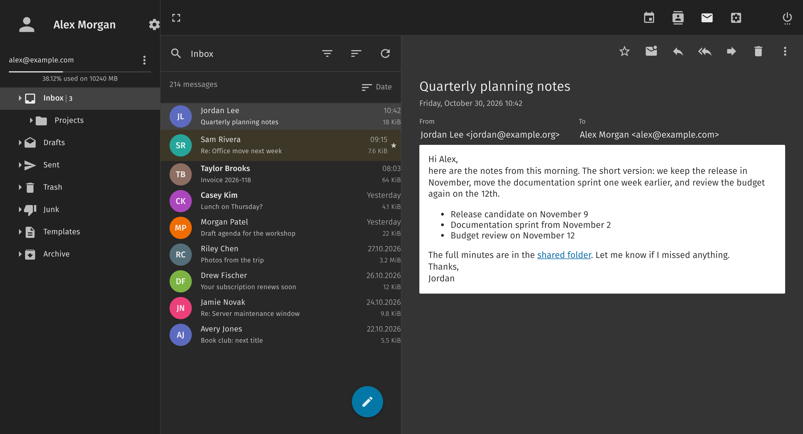
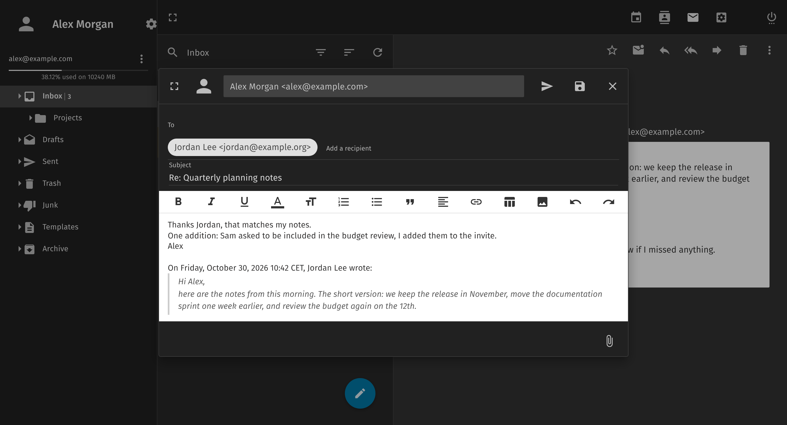
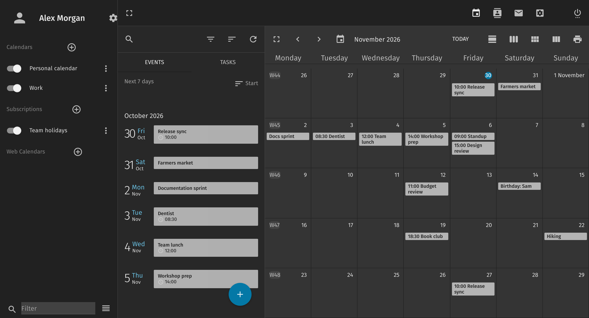
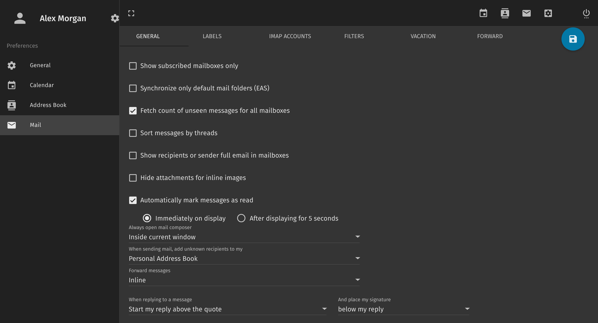

# sogo-darktheme
A dark theme for the SoGo email client. Based on the material design theme "grey" I made this very basic, mostly monochrome theme.
While at it I took the liberty to make a couple of layout elements slightly more compact without taking anything away. 

There might be visual bugs.

My SoGo v5.11 instance runs on mailcow-dockerized but this should work on any installation.

## Screenshots





## v2 theme
`v2-theme.css` is a variant of the dark theme in the v2 design system ("Night" palette): warm soot surfaces instead of grey, bone-coloured text, a magenta → ember → amber heat gradient on the main action buttons (compose, dialog confirm), amber focus rings, magenta links, checkboxes and radios, and the Bricolage Grotesque / Instrument Sans typefaces (loaded from Google Fonts). Layout tweaks are the same as in `custom-theme.css`. It also covers the light boxes and dark labels that SOGo 5.12's own stylesheet hard-codes (preference sections, drag and drop, the time picker, calendar grid lines, flagged messages and so on); it was checked against SOGo 5.12.12.

Install it exactly like the dark theme below, just use `v2-theme.css` as the source file.

## Installation
### Mailcow
Current SOGo images install to `/usr/local/lib/GNUstep`. Older guides (and older versions of this README) mount to `/usr/lib/GNUstep`, which newer SOGo versions no longer read, so the theme silently doesn't load. Use the path below.

Download [this file](https://raw.githubusercontent.com/florentineprinzessinzusachsen/sogo-darktheme/refs/heads/main/custom-theme.css) to `./data/conf/sogo/custom-theme.css` and follow [these instructions](https://docs.mailcow.email/manual-guides/SOGo/u_e-sogo/) (from step 10)

> 10. append/create docker-compose.override.yml with:
>```
> services:
>   sogo-mailcow:
>     volumes:
>       - ./data/conf/sogo/custom-theme.css:/usr/local/lib/GNUstep/SOGo/WebServerResources/css/theme-default.css:z
>```
> 11. Run:
>
>```
> docker compose up -d
>```
> 13. Run:
>``` 
> docker compose restart memcached-mailcow
>```
